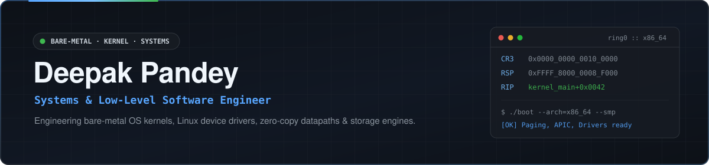

<div align="center">

<a href="https://github.com/deepak-pandey2005">
  
</a>

<p align="center">
  <a href="https://github.com/deepak-pandey2005">
    
  </a>
</p>

[](https://github.com/deepak-pandey2005/NullOS)
[](https://github.com/deepak-pandey2005)
[](https://github.com/deepak-pandey2005)
[](https://github.com/deepak-pandey2005)
[](https://github.com/deepak-pandey2005)
[](https://github.com/deepak-pandey2005)


---

</div>

```text
┌──(deepak@baremetal)-[~/kernel]
└─$ cat sysinfo.log
─────────────────────────────────────────────────────────────────────────────
Host Architecture:  x86_64 Bare-Metal / Linux 6.x
Execution Model:    Ring 0 Kernelspace ⟷ Ring 3 Userspace Isolation
Specialization:     Operating Systems, Linux Drivers, Storage Engines, NetSec
Primary Toolchain:  C (C99/C11), Rust, x86_64 Assembly (NASM/GAS), Go, Bash
Low-Level Core:     4-Level Paging, APIC/IDT, MMIO, DMA, Slub/Buddy Allocators
Systems Tooling:    QEMU, GDB, Valgrind, Make, CMake, GCC, LLVM, Perf, Wireshark
Active Research:    SMP Scheduling, VirtIO Network Stack, Driver Subsystems
─────────────────────────────────────────────────────────────────────────────
```

## 🔬 About Me

I am a systems engineer focused on peeling back layers of abstraction to understand how hardware, kernels, and compilers interact. My work spans building bare-metal `x86_64` operating systems, implementing Linux kernel device drivers, analyzing network datapaths at line rate, and architecting persistent storage engines.

- ⚙️ **Core Focus**: OS internals, virtual memory management (4-level paging, Slub/Buddy allocators), interrupt dispatching, and lock-free / low-level concurrency.
- 🛠️ **Active Research**: Symmetric Multiprocessing (SMP) scheduling, VirtIO network drivers, and Linux kernel subsystem internals.
- 🎯 **Engineering Philosophy**: *Mechanical sympathy, craftsmanship, and deterministic performance from bootloader to userspace.*

---

## 🖥️ Kernel Terminal

```text
┌──(deepak@baremetal)-[~/kernel]
└─$ ./bootctl --inspect
───────────────────────────────────────────────────────────────────────────────
   _   _       _ _  ___  ____
  | \ | |_   _| | |/ _ \/ ___|      Arch     : x86_64 (Long Mode / Ring 0)
  |  \| | | | | | | | | \___ \      Kernel   : NullOS · Linux 6.x Drivers
  | |\  | |_| | | | |_| |___) |     Memory   : PML4 4-Level Paging + Slub
  |_| \_|\__,_|_|_|\___/|____/      Datapath : Zero-Copy Ring + LSM Storage
───────────────────────────────────────────────────────────────────────────────
  [  0.000000] UEFI: Handing off control to 64-bit kernel_main...
  [  0.001420] MMU:  4-level paging enabled (CR3 = 0x0000000000100000)
  [  0.002890] APIC: Local APIC & IDT initialized · SMP cores online
  [  0.004115] VFS:  Char drivers, ioctl, MMIO & DMA ring buffers ready
  [  0.005602] NET:  AF_PACKET zero-copy datapath engine listening
  [  0.006940] KV:   WAL replayed · MemTable & SSTable bloom filters active
  [  OK  ]     System ready. Awaiting ring-3 syscalls... ▌
───────────────────────────────────────────────────────────────────────────────
```

---

## 🛠️ Technical Arsenal

<div align="left">

| Domain | Technologies &amp; Competencies |
| :--- | :--- |
| **Languages** | `C (C99/C11)`, `Rust`, `x86_64 Assembly (NASM/GAS)`, `Go`, `Bash`, `Python` |
| **Kernel &amp; OS Internals** | 4-Level Paging, Physical Frame Allocator, Virtual Memory, Interrupt Handling (APIC/IDT), Task Scheduling, Context Switching, Ring 0/Ring 3, Fast Syscalls |
| **Linux Subsystems** | Kernel Modules, Character Devices, Platform Drivers, Device Trees, `ioctl`, `sysfs`, `procfs`, MMIO/DMA, eBPF, kprobes |
| **Networking &amp; Storage** | `AF_PACKET`, Raw Sockets, Zero-Copy Ring Buffers, Protocol Parsing, LSM-Trees, WAL, SSTables, Bloom Filters |
| **Systems Tooling** | `QEMU`, `GDB`, `LLDB`, `Make`, `CMake`, `Valgrind`, `Objdump/Readelf`, `Perf`, `Wireshark`, `Git` |

</div>

---

## 📊 Engineering Activity & Metrics

<div align="center">


<br/>


<br/><br/>


</div>

---

## 📬 Let's Connect

<p align="center">
  <a href="mailto:deepak.os.system@gmail.com">
    
  </a>
  <a href="https://github.com/deepak-pandey2005">
    
  </a>
  <a href="https://linkedin.com">
    
  </a>
</p>

<div align="center">
  <sub><i>"The best way to understand an abstraction is to build what lies beneath it."</i></sub>
</div>
